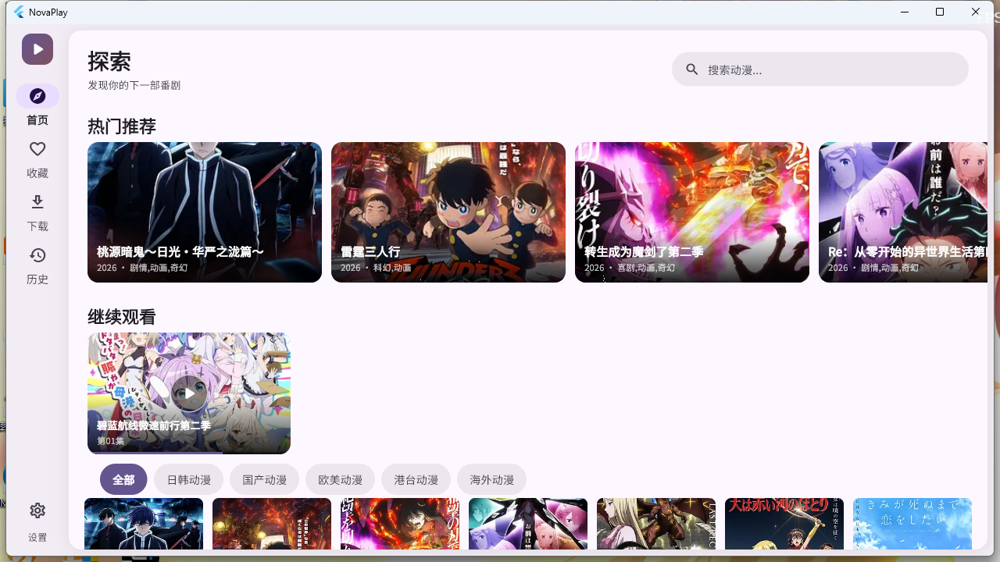
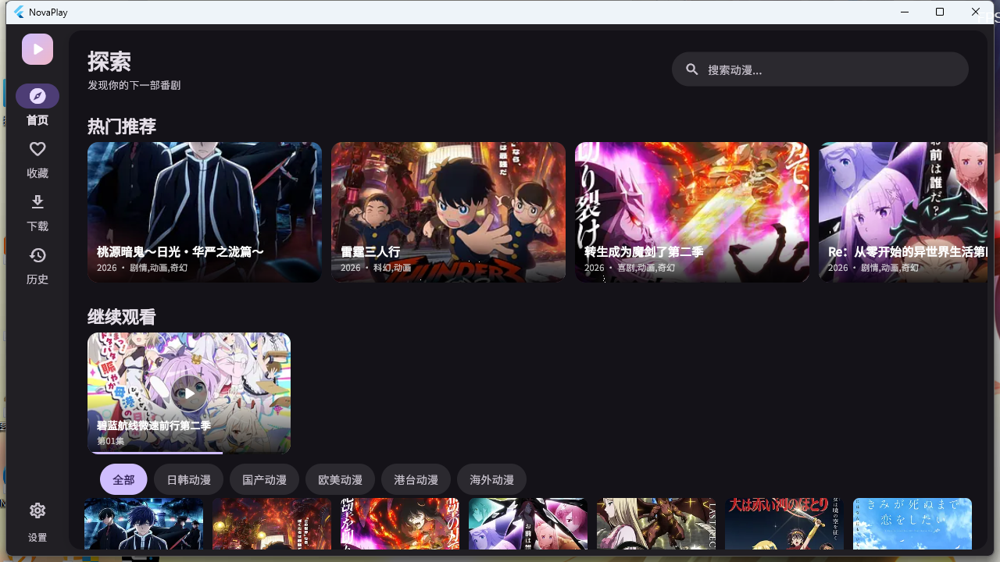

# NovaPlay

一款面向 Windows 的动漫聚合播放器，基于 Flutter + media_kit 构建。抓取在线源、海报流式浏览、追番式收藏与观看历史续播，并内置了完整的桌面播放器控制栏。

> ⚠️ 本项目仅供学习与 Flutter 桌面开发交流使用，不提供、不托管任何视频资源。所有内容的版权归原权利人所有。

## 界面预览

| 浅色主题 | 深色主题 |
| :---: | :---: |
|  |  |

## 功能

- **在线源聚合** — maccms 风格 API 抓取，主源失败自动回退备用源；多 CDN 自动择优
- **探索首页** — 16:9 热门横卡、继续观看、分类筛选、自适应海报网格、无限滚动
- **全屏搜索** — 胶囊搜索框、类型筛选 chips、结果计数、海报/列表双视图、搜索历史持久化
- **详情页三栏** — 海报列 / 信息列（选集缩略图卡、角色行）/ 数据列（Bangumi 评分、制作人员）
- **播放器** — media_kit(mpv) 播放 m3u8；进度条含缓冲指示、倍速、音量、上下集、真全屏切换
- **键盘快捷键** — 空格播放暂停、`←`/`→` 快退快进、`↑`/`↓` 音量、`F` 全屏、`Esc` 退出（支持长按连发）
- **收藏与历史** — 追番式宽横卡、观看进度持久化、一键续播、单条删除与清空
- **双主题** — Material 3 种子色生成浅/深主题，支持跟随系统，选择持久化
- **元数据刮削** — Bangumi 公开 API 补充评分、制作人员、角色与 CV，失败静默降级

## 技术栈

| 层 | 选型 |
|---|---|
| 框架 | Flutter 3.29.3 / Dart 3.7.2 |
| 视频播放 | media_kit（mpv 内核）+ audio_video_progress_bar |
| 状态管理 | flutter_riverpod（手写 StateNotifierProvider，未用 codegen） |
| 路由 | go_router（StatefulShellRoute 分支 + 全屏页） |
| 网络 | dio |
| 存储 | shared_preferences |
| UI | Material 3、google_fonts、cached_network_image |

## 快速开始

### 环境要求

- Flutter 3.29.3+（Dart 3.7.2+）
- Windows 10/11 + Visual Studio 2022/2026（C++ 桌面开发负载）

### 构建运行

```bash
# 国内网络可先设置镜像
export PUB_HOSTED_URL="https://pub.flutter-io.cn"
export FLUTTER_STORAGE_BASE_URL="https://storage.flutter-io.cn"

flutter pub get
flutter run -d windows          # 开发调试
flutter build windows --release # 产物在 build/windows/x64/runner/Release/
```

### 测试

```bash
flutter analyze   # 静态检查
flutter test      # 单元测试 + 组件测试（全部离线，无需网络）
```

## 项目结构

```
lib/
├── core/
│   ├── config/        # 主题（M3 双主题）、路由
│   ├── network/       # dio 封装
│   └── utils/         # 播放器启动 helper
├── models/            # VideoModel / HistoryItem / BangumiInfo
├── providers/         # Riverpod providers（视频流、搜索、收藏、历史、主题）
├── services/
│   ├── scraper/       # 数据源实现（LziApi / AniList）与注册表
│   ├── bangumi_api.dart
│   └── database_service.dart
├── shared/widgets/    # 主骨架、海报卡、宽横卡
└── features/          # 首页 / 搜索 / 详情 / 播放器 / 收藏 / 历史 / 下载 / 设置
```

## 开发进度

- [x] **Phase 0** 代码基线清理（analyze 0 issue）
- [x] **Phase 1** 收藏 / 观看历史 / 续播 / 搜索历史持久化
- [x] **Phase 2** UI 重做：M3 双主题设计系统、NavigationRail 骨架、全页面重构、播放器控制栏与快捷键
- [ ] **Phase 3** 下载系统：纯 Dart m3u8 分片下载器（断点续传、任务持久化）
- [ ] **Phase 4** 弹幕：canvas_danmaku + 弹弹play 数据源
- [ ] **Phase 5** 打包分发：msix 安装包、应用图标、应用内更新

详细的技术决策、踩坑记录与后续路线见 [开发报告.md](开发报告.md)。

## 免责声明

1. 本项目为技术学习项目，**不提供、不存储、不分发任何视频资源**，所有播放内容均来自第三方公开接口。
2. 程序仅做网络请求与本地播放，不对内容合法性负责。使用者应自行遵守所在地法律法规。
3. 若相关权利人认为本项目存在侵权，请通过 issue 联系，将及时处理。

## 许可

[MIT License](LICENSE)
