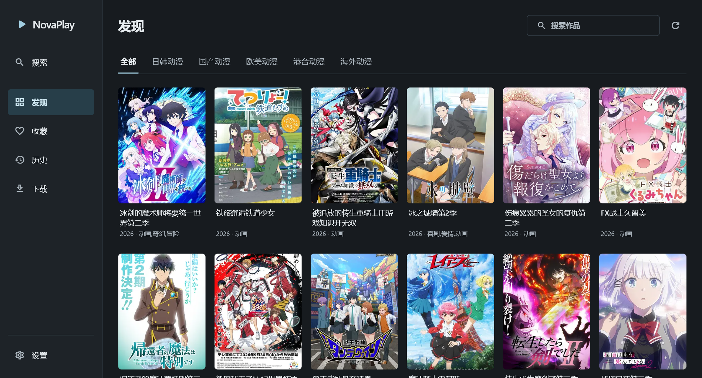
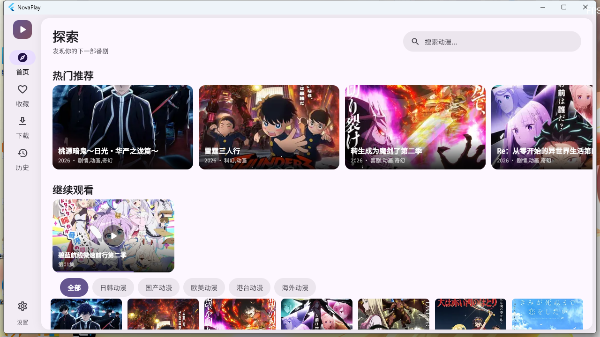

# NovaPlay

Windows 上的动漫聚合播放器，用 Flutter 和 media_kit 编写。可以浏览在线片库、搜索作品、选集播放，也能把作品加入收藏，从观看历史接着看。

目前仍在开发，可从源码运行或自行构建 Windows 运行版。分类与搜索分页、独立播放窗口、HLS 离线下载及可选弹幕已合入；跨进程历史保存、下载暂停进度及播放器重连问题已分轮修复并完成回归，具体验证范围见下方。可下载版本以[主仓库 Releases](https://github.com/QIAN-SHU-QAQ/NovaPlay/releases) 为准。



<details>
<summary>查看浅色主题</summary>



</details>

[运行方法](#从源码运行) · [下一阶段开发与验收](docs/reviews/2026-11-04-development-direction.md) · [开发报告](开发报告.md) · [反馈问题](https://github.com/QIAN-SHU-QAQ/NovaPlay/issues)

## 现在能做什么

- 浏览片库和分类，按标题搜索，查看简介与剧集列表；分类与搜索结果都支持无限滚动分页加载。
- 播放在线视频，切换剧集、倍速、音量和窗口全屏；播放失败时可重试。**视频在独立的播放窗口中打开**，关掉视频窗口不会退出主界面，可以边看边浏览；可在设置里开启「自动播放下一集」并配置默认倍速。
- 播放时显示弹幕：数据来自弹弹play 开放弹幕网络，按作品名/集数自动匹配；在设置里填写免费的 AppId/AppSecret 后可调整透明度、字号、显示区域，播放器内可一键开关。
- 保存收藏、搜索历史和观看进度，从首页或历史页继续播放；独立播放进程的观看进度会实时同步到主窗口，主窗口重启后旧播放器也能自动重连。
- 切换浅色、深色或跟随系统的主题，重启后保留选择。
- 在设置里管理数据源：启用/停用、切换主源、测速、添加自定义 maccms 源（主源失败自动回退到其它启用源）。
- 在详情页选集卡片上点击下载按钮，把剧集离线保存到本机（支持暂停/继续/删除、在文件夹中显示，重启后任务列表保留，完成后可直接在下载页点击播放）。
- 从 Bangumi 补充评分、制作人员和角色资料，查不到时仍可查看作品和播放。

搜索可以从侧栏或发现页右上角打开。播放器使用深色控件。

播放快捷键：空格暂停或继续，`←` / `→` 快退快进，`↑` / `↓` 调整音量，`F` 全屏，`Esc` 退出全屏。

## 使用前需要知道

在线内容依赖第三方接口，作品、图片和播放地址可能失效。主源请求异常时会尝试备用源，全部失败时显示错误并支持重试；正常的空结果不会触发回退。

首页、分类和搜索结果都支持继续加载。Bangumi 资料按标题搜索并取首项，可能匹配到同名作品或其他季度。

弹幕为可选功能：需要先在[弹弹play 开发者中心](https://dev.dandanplay.com)免费申请 AppId/AppSecret，填入「设置 → 弹幕 → 弹弹play 账号」。未配置时不会加载弹幕，播放器右侧会显示提示。弹幕按作品名 + 集数自动匹配，作品标题差异较大（如改名、剧场版）时可能匹配不到；匹配结果会显示在播放器右侧面板底部。

下载功能已接通：详情页选集卡片旁的下载按钮可加入队列，下载页支持暂停、继续、删除和在文件夹中显示，任务在重启后保留。完成后点击任务即可在应用内播放，也可用第三方播放器打开保存的 `.ts` 文件。文件默认保存在系统“文档”目录下的 `NovaPlay/Downloads/`。当前只支持**未加密的 m3u8 分片流**，加密流会显式报错。

设置页可保存主题、配置自动连播与默认倍速，并可在「源管理」中启停、切换、测速或添加自定义数据源。应用内自动更新尚未实现。

收藏和观看历史保存在本机，没有账号同步。旧历史里的播放地址可能过期，此时可回到作品详情重新选集。

播放窗口是独立进程：每打开一个播放窗口都会启动一个 NovaPlay 进程，关闭播放窗口只结束对应进程，主窗口仍可继续浏览。多个进程写同一份本地配置会互相覆盖，因此**主窗口进程是唯一持久化写入方**：播放器把观看进度、收藏、搜索历史以“语义操作”（例如 upsert 某一条历史）发给主进程，由主进程在最新数据上合并，多个播放窗口同时写也不会互相覆盖；主窗口收到变更后会即时刷新历史/收藏。主窗口关闭时播放器不直接写整份配置，而是把操作写入本地日志（journal），下次启动主窗口时自动合并回放。主窗口重启后会监听新端口并更新端点文件（含会话 token），仍在运行的旧播放器在重试时自动发现并重连，积压的操作随后补交。下载任务配置只由主窗口进程写入。

### 修复状态与限制

2026-11-03/04 的 Windows 实机检验发现的问题，已通过 [PR #4](https://github.com/QIAN-SHU-QAQ/NovaPlay/pull/4)、[PR #5](https://github.com/QIAN-SHU-QAQ/NovaPlay/pull/5)、[PR #6](https://github.com/QIAN-SHU-QAQ/NovaPlay/pull/6) 以及后续 R1–R7 修复分轮处理：

- **观看历史可能丢失（已修复）。** 独立播放器写入的新记录以语义操作（upsert）交给主窗口进程，由主进程在最新历史列表上合并，多个播放器同时写也不会互相覆盖；主窗口历史页会即时刷新，修改“自动播放下一集”等设置不会再覆盖新历史。主窗口关闭期间播放器的操作会写入离线日志，下次启动时合并。
- **暂停下载会重置进度显示（已修复）。** 取消/异常分支改为基于当前任务写回状态，暂停后保留最新进度；继续下载仍会从断点恢复并完成。
- **主窗口重启后旧播放器实时同步中断（已修复并实测）。** 在提交 `2da2d91` 上，保留同一批两个播放器，连续关闭、重开主窗口两次；两轮均能自动发现新会话，观看时间持续更新，离线日志清空，历史与新增收藏保留。旧会话请求被拒绝，当前会话请求正常。
- **断点下载可能混拼旧分片（已修复）。** 分片目录保存清单指纹、分片 URI、大小与 SHA-256；只有清单一致、本地文件大小与哈希一致才复用，分片先写 `.part` 再原子改名；清单变化或超过复用时限时清空重下，不再只凭数组位置复用。
- **部分不支持的 HLS 格式被当成功（已修复）。** 下载器在下载主体前明确拒绝 fMP4（`EXT-X-MAP`）、`EXT-X-BYTERANGE`、独立音轨（`EXT-X-MEDIA:TYPE=AUDIO`）、直播/滚动列表和加密流，不会输出缺少初始化段的文件却报告完成。
- **失效播放地址续播（已修复）。** 从首页/历史/收藏续播前先刷新作品详情，按集标题重新定位剧集并取新播放地址；刷新失败或找不到对应集时回退详情页，不再直接播放过期快照地址。
- **弹幕错季匹配（已修复）。** 匹配时解析季数并排除跨季候选，相似度不足返回未匹配；播放器新增「手动匹配弹幕」，选择后按作品+集持久化，重启后仍生效，可恢复自动匹配。
- **Bangumi 资料错配（已修复）。** 搜索结果按标题/中文名/季数相似度排序，不再取首项，相似度不足时不关联；详情页新增手动匹配并持久化，角色接口失败时仍返回评分与制作人员。

后续代码评估还在跟踪剩余边界问题与 Windows 预览版交付（R1/R2/R3/R6 修复在其他 PR，R8 为 CI 构建、便携包与干净机器验收），具体复现和验收要求见[下一阶段开发与验收](docs/reviews/2026-11-04-development-direction.md)。上述已通过的回归结论仅限当时列出的场景。

第三方片源失效、旧历史播放地址过期及 Bangumi 同名作品误匹配，仍需要在使用中留意。

## 从源码运行

项目以 Windows 桌面端为开发和验证目标。准备 Git、Flutter SDK，以及带有 C++ 桌面开发组件和 Windows SDK 的 Visual Studio。

`pubspec.yaml` 要求 Dart `^3.7.2`，没有单独声明 Flutter 最低版本。本地验证使用 Windows 11、Flutter 3.29.3 / Dart 3.7.2；Visual Studio 2026 的使用依赖本地 Flutter 工具补丁，环境细节见[开发报告](开发报告.md#构建环境)。

两个在 Windows 上实际踩过的前提：

- **开启 Windows 开发者模式**（设置 → 系统 → 开发者选项）。插件构建要创建符号链接，否则 `flutter pub get` 会警告、`flutter build windows` 会直接失败。
- **项目路径不要包含中文/非 ASCII 字符**。着色器编译器（impellerc）无法写入非 ASCII 路径，构建会报 `Could not write file .../ink_sparkle.frag`。如果仓库在中文目录，可用目录联接从 ASCII 路径构建：

  ```powershell
  New-Item -ItemType Directory -Path E:\dev -Force
  New-Item -ItemType Junction -Path E:\dev\NovaPlay -Target "E:\项目\NovaPlay"
  Set-Location E:\dev\NovaPlay
  flutter build windows
  ```

在 PowerShell 中运行：

```powershell
git clone https://github.com/QIAN-SHU-QAQ/NovaPlay.git
cd NovaPlay
flutter doctor -v
flutter pub get --enforce-lockfile
flutter run -d windows
```

如果下载依赖遇到网络问题，可以先在当前 PowerShell 会话设置镜像，再执行 `flutter pub get`：

```powershell
$env:PUB_HOSTED_URL = "https://pub.flutter-io.cn"
$env:FLUTTER_STORAGE_BASE_URL = "https://storage.flutter-io.cn"
```

切换包源后请检查 `pubspec.lock` 的差异，避免把源切换引起的依赖版本变化混入其他修改。复现下面的检验结果时，应使用仓库锁定的版本。

### 检查与构建

```powershell
flutter analyze
flutter test
flutter build windows --release
```

仓库已配置 GitHub Actions：主分支 push 和 PR 的受控 CI 会检查自动化策略、Dart 格式、`flutter analyze`、`flutter test` 并构建 Windows Release。PR 由主分支机器人自动派发验证；纯文档满足条件后自动合并，代码需要当前提交的维护者审核，关键代码还需专项验收。规则和异常处理见 [PR 自动检查与合并](.github/AUTOMATION.md)。

测试使用离线替身，不需要请求在线片库。实际播放与第三方接口的可用性需要另行实测。

2026-11-04 在 Windows、Flutter 3.29.3 / Dart 3.7.2 下，针对合并提交 [`2da2d91`](https://github.com/QIAN-SHU-QAQ/NovaPlay/commit/2da2d91dd3ab86b2660dc8c85e40135a8f2bef39) 使用锁定依赖完成检验：

| 检查 | 结果 |
| --- | --- |
| Dart 格式检查 | 78 个文件，0 修改 |
| `flutter analyze` | 无问题 |
| `flutter test` | 120 个测试全部通过 |
| Windows Release 构建 | 成功 |
| 双播放器跨两次主窗口重启 | 两轮自动重连，两个作品的观看时间持续推进 |
| 离线日志与数据保留 | 两轮积压日志均清空，两条历史及主窗口新增收藏保留 |
| 会话检查 | 携带旧会话的请求被拒绝，当前会话请求成功 |

本轮实机回归使用本地测试源与公开 HLS 样片，重点验证跨进程存储和重连。此前已分轮验证在线播放、全屏按钮及 Esc 恢复、分类和搜索分页、HLS 下载、离线播放、暂停后重启续传及自动切集；本轮未重新操作全部功能，也未做长期压力测试或安装包验收。

**真实弹幕服务仍未完成验收**：没有有效的弹弹play AppId/AppSecret，尚未验证真实服务的鉴权、匹配和滚动效果。以上通过结论限定于列出的检查与操作场景。

构建目录为 `build/windows/x64/runner/Release/`。运行或复制程序时，请保留整个目录，包括 DLL 和 `data/`；只复制 `nova_play.exe` 无法正常运行。

### Windows 播放失败排查（Low 完整性标签）

如果播放时界面显示：

```
PathAccessException: Cannot create file, path = '\?\C:\Users\<用户>\AppData\Local\Temp\...' (OS Error: 拒绝访问, errno = 5)
```

通常是**运行目录里的文件带了 Low 完整性标签**（某些沙箱化构建/复制环境会把子进程降到 Low IL，其产物会继承 Low 标签）。Windows 会据此以 Low 完整性启动程序，media_kit 因此无法在 `%TEMP%` 创建临时播放列表文件，视频无法播放。

检查与修复（在 PowerShell 中执行）：

```powershell
# 查看是否带 Low 标签
icacls "E:\项目\NovaPlay\运行版" /T | Select-String "Mandatory Label"
# 统一改成 Medium（对整个运行目录执行一次）
icacls "E:\项目\NovaPlay\运行版" /setintegritylevel Medium /T
```

修复后重新启动应用，任务管理器中 `nova_play.exe` 的完整性级别应为「中等 / Medium」。以后每次构建并复制到运行目录后，如果构建环境是沙箱（或用脚本部署），都需要重新执行这条命令；仓库里的 `scripts/deploy-release.ps1` 会自动完成复制、修正标签和更新快捷方式：

```powershell
powershell -ExecutionPolicy Bypass -File scripts\deploy-release.ps1
```

### 构建 Windows 便携预览包

仓库提供 `scripts/package-portable.ps1`：从 Release 构建目录生成版本化便携 ZIP、附使用说明与许可，并输出 SHA-256 校验文件。缺少 exe/DLL/`data/` 或发现日志、缓存、个人配置等不应分发的文件时会直接失败。

```powershell
flutter build windows --release
powershell -ExecutionPolicy Bypass -File scripts\package-portable.ps1
```

产物在 `dist/`：`NovaPlay-<版本>-windows-x64.zip` 与同名 `.sha256`。CI 工作流 [windows-build](.github/workflows/windows-build.yml) 会在干净的 Windows runner 上执行锁定依赖解析、格式、分析、测试、Release 构建和打包；手动触发时可选择创建 draft Release，由维护者核对资产后再公开。干净机器验收（无 Flutter/VS、含中文和空格路径）仍需人工执行并记录。


## 参考

弹幕功能选型时做过的调研（结论：渲染直接用 MIT 依赖，数据协议自行实现）：

| 项目或文档 | 本项目中的用途 |
| --- | --- |
| [Predidit/canvas_danmaku](https://github.com/Predidit/canvas_danmaku) | 直接依赖，使用 Dart Canvas 渲染弹幕 |
| [Predidit/Kazumi](https://github.com/Predidit/Kazumi) | 流程参考，未直接复用代码 |
| [open-ani/animeko](https://github.com/open-ani/animeko) | 协议实现参考，未直接复用代码 |
| [弹弹play 开放 API](https://doc.dandanplay.com/open/) | 弹幕数据来源，需要配置 AppId/AppSecret |

## 继续开发

当前开发依据是[下一阶段开发方向与验收要求](docs/reviews/2026-11-04-development-direction.md)。任务分为 R1–R8，各有自动化用例、实机步骤、预期结果和证据要求：

1. **先修正确性：** 优先 R1 历史有序补交、R2 下载完整性，再完成 HLS 格式边界、地址刷新续播、弹幕匹配、配置桥协议和 Bangumi 资料关联。
2. **再交付 Windows 预览版：** CI 构建、完整便携 ZIP 与 SHA-256 已落地（`.github/workflows/windows-build.yml`、`scripts/package-portable.ps1`）；旧数据兼容和干净机器验收仍需人工执行并记录。
3. **随后完善追番体验：** 想看/在看/看完、更新发现、下载路径、数据备份与故障诊断。

贡献者优先领取 R1，其次 R2；PR 写明对应编号、修复前后回归和实际验收结果。真实服务或干净机器条件不足时明确标记“未验收”，不能用离线测试替代。

分页、播放设置、下载与弹幕的基础实现已随 [PR #3](https://github.com/QIAN-SHU-QAQ/NovaPlay/pull/3) 合入。[开发报告](开发报告.md)和早期开发计划中的待办需要按当前实现重新核对，不能再将这些功能全部视为尚未实现。

报告问题时，附上 Windows 版本、操作步骤、出错页面和错误信息；涉及播放时补充作品、集数及是否能重现。请勿提交个人凭据。

代码采用 [MIT 许可](LICENSE)。应用从第三方接口读取内容，仓库不托管视频；视频、海报和作品资料的权利归各自权利人。
